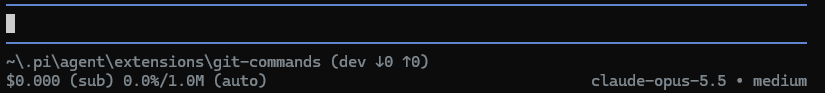

# pi-git-commands

[](https://www.npmjs.com/package/@svyaddict/pi-git-commands)
[](https://www.npmjs.com/package/@svyaddict/pi-git-commands)
[](LICENSE)
[](https://pi.dev/packages)

> Everyday git workflow, right inside [pi](https://pi.dev) — check status, fetch, pull, push, switch, create and clean up branches without leaving the agent, and always know whether you are ahead or behind your upstream.

## Features

- 📋 **`/git status`** — compact summary of conflicts, staged, unstaged and untracked files, with `↓incoming ↑outgoing` counters.
- 📡 **`/git fetch`** — fetch all remotes and prune stale branches, then tell you whether there is something to pull.
- 🔄 **`/git pull`** — fast-forward pull and prune in one step; never merges or rebases on your behalf. Offers to set the upstream when it is missing.
- 🚀 **`/git push`** — push the current branch; when it has no upstream, pi picks the remote and sets it. Never force-pushes.
- 🌿 **`/git branch`** — list branches, switch to one, check out a remote branch with tracking, or create a new one.
- 🧹 **`/git cleanup`** — delete branches already merged or whose upstream is gone, after confirmation.
- ⌨️ **Autocomplete** — subcommands and branch names (local and remote) are suggested as you type.
- 📊 **Git-aware footer** — current branch with `↓incoming ↑outgoing` commit counters, refreshed automatically, alongside the usual token, cost and context stats. Turn it on or off for every session with `/git footer on|off`.
- 🔒 **Never hangs on a prompt** — git runs non-interactively: missing credentials fail fast instead of blocking pi.

## Installation

```bash
pi install npm:@svyaddict/pi-git-commands
```

Then start pi inside a git repository and type `/git`. Other ways to install (from GitHub, per project, single session), updating and removing are covered in the [installation guide](https://github.com/svyaddict/pi-git-commands/blob/main/docs/installation.md).

Requires git on your `PATH` and Node.js `>= 22.19.0`.

### Upgrading from 0.1.x

Run `pi update npm:@svyaddict/pi-git-commands` to get the latest version. Version 0.2.0 changes `/git pull`: it now only fast-forwards, whatever `pull.rebase` says. When your branch and its upstream have diverged, it reports it and leaves the branch untouched instead of merging or rebasing: integrate the changes yourself, then pull again. See the [changelog](https://github.com/svyaddict/pi-git-commands/blob/main/CHANGELOG.md) for everything new.

## Commands

| Command | What it does |
|---|---|
| `/git status` | Summary of conflicts, staged, unstaged and untracked files |
| `/git fetch` | Fetch all remotes, prune stale branches, report incoming commits |
| `/git pull` | Fast-forward the current branch, setting its upstream if needed |
| `/git push` | Push the current branch, setting its upstream if needed |
| `/git branch` | List local branches (`>` current, `*` local only) |
| `/git branch <name>` | Switch to a branch, check out a remote one, or create it |
| `/git cleanup` | Delete merged branches and branches whose upstream is gone |
| `/git footer [on\|off]` | Show or change whether the git footer is used, in every session |

Every command, with examples and edge cases: **[docs/commands.md](https://github.com/svyaddict/pi-git-commands/blob/main/docs/commands.md)**.

## Footer



Next to the branch name, `↓` counts commits to pull and `↑` commits to push. `↓` reflects the last fetch: run `/git fetch` to update it. To keep pi's built-in footer instead, run `/git footer off` once: the choice is saved and applies to every session. Details: **[docs/footer.md](https://github.com/svyaddict/pi-git-commands/blob/main/docs/footer.md)**.

## Documentation

- [Commands](https://github.com/svyaddict/pi-git-commands/blob/main/docs/commands.md): every command in detail
- [Footer](https://github.com/svyaddict/pi-git-commands/blob/main/docs/footer.md): counters, refresh, stats, turning it on or off
- [Installation](https://github.com/svyaddict/pi-git-commands/blob/main/docs/installation.md): all install options and compatibility notes
- [Development](https://github.com/svyaddict/pi-git-commands/blob/main/docs/development.md): project layout, adding a command, releasing

## Contributing

Bug reports, ideas and pull requests are welcome. See [CONTRIBUTING.md](https://github.com/svyaddict/pi-git-commands/blob/main/CONTRIBUTING.md).

## Changelog

See [CHANGELOG.md](https://github.com/svyaddict/pi-git-commands/blob/main/CHANGELOG.md).

## License

[MIT](LICENSE) © [svyaddict](https://github.com/svyaddict)
