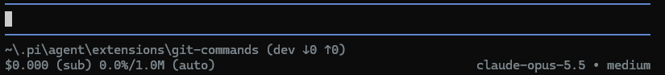

# Git-aware footer

In interactive (TUI) mode, pi-git-commands replaces pi's footer with one that also shows where your branch stands compared to its remote. It is on by default; turn it off with [`/git footer off`](#turning-it-on-or-off).



A busier session looks like this:

```text
~/projects/my-app (main ↓2 ↑1) • my-session
↑12k ↓3.4k R45k W8k CH78.3% $0.123 21.4%/200k (auto)        (anthropic) claude-sonnet • medium
```

## First line: location and branch

- The working directory (with `~` for your home), the current branch and the session name.
- `↓N`: commits on the remote that you have not pulled yet.
- `↑N`: local commits that you have not pushed yet.

### Where the counters compare to

| Branch state | `↓` | `↑` |
|---|---|---|
| Has an upstream | commits on the upstream not in your branch | commits in your branch not on the upstream |
| No upstream, same-named branch on a remote (`origin` preferred) | compared to that branch | compared to that branch |
| No upstream, not on any remote (never pushed) | always `0` | commits that are on no remote at all |
| Detached HEAD, or repository without remotes | not shown | not shown |

### When they update

- every 12 seconds;
- when the branch changes;
- right after every `/git` command.

> **`↓` is as of the last fetch.** The footer never contacts the remote by itself, so new remote commits appear only after a fetch: run [`/git fetch`](commands.md#git-fetch) or [`/git pull`](commands.md#git-pull).

## Second line: session stats

The same stats as pi's built-in footer:

| Item | Meaning |
|---|---|
| `↑12k` / `↓3.4k` | input / output tokens |
| `R45k` / `W8k` | cache reads / writes |
| `CH78.3%` | cache hit rate of the latest request |
| `$0.123` | session cost; `(sub)` when the provider is subscription-backed |
| `21.4%/200k` | context used / context window; yellow above 70 %, red above 90 % |
| `(auto)` | auto-compaction is enabled |
| right side | provider (when more than one is available), model and thinking level |

A third line shows statuses set by other extensions, if any.

**Not shown**: the extension API does not expose everything the built-in footer has, so the routed model of virtual models (`→ model`) and the experimental-features badge (`xp`) are missing.

## Turning it on or off

```text
/git footer          show the current setting
/git footer off      use pi's built-in footer
/git footer on       use the git footer (default)
```

- The change applies right away in the current pi session.
- It is saved in `~/.pi/agent/pi-git-commands.json` (pi's agent directory, or `$PI_CODING_AGENT_DIR` if you moved it), so it applies to every pi session in every terminal. pi windows that are already open pick it up after `/reload`.
- `/git footer` works anywhere, also outside git repositories. The footer itself is only shown in interactive mode inside a git repository.

The settings file is plain JSON that you may also edit by hand:

```json
{
	"footer": false
}
```

If the file is not valid JSON, pi starts with the default (footer on) and `/git footer` tells you what is wrong instead of overwriting your file.

## Other footer extensions

The footer is replaced with `ctx.ui.setFooter()`. If another extension also replaces the footer, the one that loads last wins. Run `/git footer off` to let the other one win.
